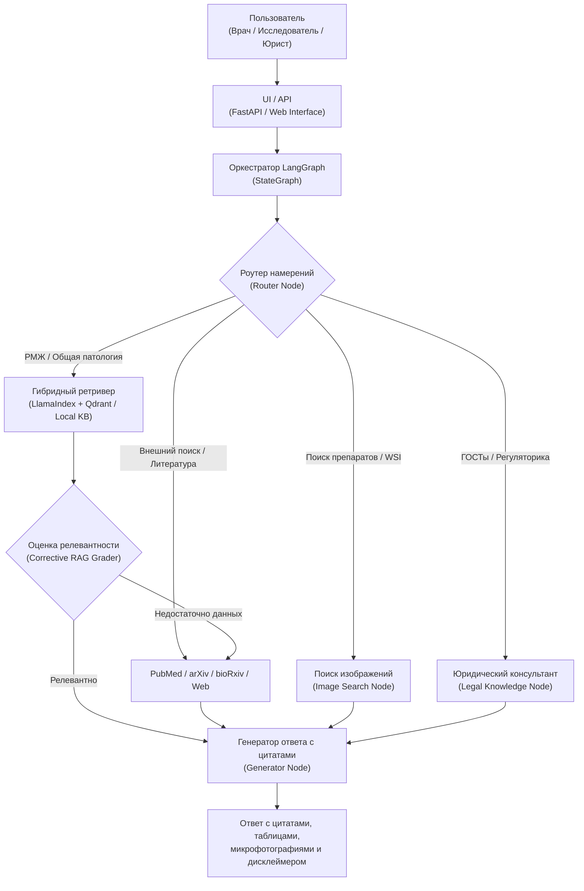

# ОПИСАНИЕ АРХИТЕКТУРЫ И ИНФОРМАЦИОННОГО ОБЕСПЕЧЕНИЯ
## Автоматизированная система «Pathology RAG»
### Обозначение документа: АС-ПАТ-RAG.ОА
*(Разработано в соответствии с ГОСТ Р 59795-2021)*

---

### 1. СТРУКТУРА СИСТЕМЫ И ВЗАИМОДЕЙСТВИЕ КОМПОНЕНТОВ

Система реализует агентную событийно-ориентированную RAG-архитектуру:



---

### 2. ИНФОРМАЦИОННОЕ ОБЕСПЕЧЕНИЕ И СХЕМЫ ДАННЫХ

#### 2.1. Схема текстового чанка (Qdrant collection: `pathology_text`)
```json
{
  "id": "uuid5(doc_id + chunk_index)",
  "vector": "[bge-m3 1024-dim dense vector]",
  "payload": {
    "source_id": "string (напр. 'who_breast_tumours', 'strukov_serov')",
    "book_title": "string (наименование издания)",
    "chapter": "string (глава)",
    "section_path": "string (полный иерархический путь раздела)",
    "page_start": 142,
    "page_end": 145,
    "nosology": "string (основная нозологическая единица)",
    "organ": "string (орган/ткань)",
    "language": "ru | en",
    "content_type": "text | table",
    "char_len": 1420
  }
}
```

#### 2.2. Схема метаданных микропрепаратов (Qdrant collection: `pathology_images`)
```json
{
  "id": "uuid5(source_id + image_id)",
  "vectors": {
    "caption": "[bge-m3 1024-dim text vector]",
    "image": "[PLIP/CONCH visual embedding vector]"
  },
  "payload": {
    "title": "string",
    "diagnosis": "string",
    "organ": "string",
    "stain": "string (H&E, ИГХ HER2, Ki-67, Судан III и др.)",
    "magnification": "string (100x, 200x, 400x)",
    "caption": "string",
    "source_id": "string",
    "source_name": "string",
    "image_url": "string (URL миниатюры)",
    "wsi_url": "string (глубокая ссылка на просмотр в WSI-вьюере)"
  }
}
```

---

### 3. ПРОГРАММНОЕ И ТЕХНИЧЕСКОЕ ОБЕСПЕЧЕНИЕ

- **Среда выполнения:** Python 3.11+, Docker / Docker Compose.
- **Векторная СУБД:** Qdrant v1.12+ (порт 6333).
- **Файловое хранилище:** MinIO / локальная файловая система (`data/images`).
- **Фреймворки:** `langgraph`, `llama-index-core`, `fastapi`, `pydantic`.
- **Эмбеддинги:** `BAAI/bge-m3` (многоязычный плотный + разреженный поиск) и `vinid/plip` (визуальные эмбеддинги патологии).
