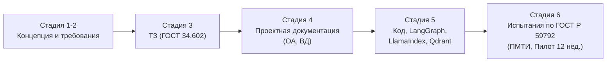

# ВЕДОМОСТЬ ДОКУМЕНТОВ (ВД)
## Комплект технической и эксплуатационной документации на систему «Pathology RAG»
### Обозначение системы: АС-ПАТ-RAG.ВД
*(Разработано в соответствии с ГОСТ 34.201-2020 и ГОСТ Р 59795-2021)*

---

### 1. ПЕРЕЧЕНЬ ПРОЕКТНЫХ, ПРОГРАММНЫХ И ЭКСПЛУАТАЦИОННЫХ ДОКУМЕНТОВ

| № п/п | Обозначение документа | Наименование документа | Код документа по ГОСТ 34.201-2020 | Статус / Срок разработки |
| :--- | :--- | :--- | :--- | :--- |
| 1 | АС-ПАТ-RAG.ТЗ | Техническое задание на автоматизированную систему | ТЗ | Утвержден (Этап 0) |
| 2 | АС-ПАТ-RAG.ВД | Ведомость документов | ВД | Утвержден (Этап 0) |
| 3 | АС-ПАТ-RAG.ОА | Описание архитектуры и информационного обеспечения | П3 / ОА | Разработан (Этап 0) |
| 4 | АС-ПАТ-RAG.НО | Назначение, ограничения и регуляторный статус (Non-SaMD) | ОП | Разработан (Этап 0) |
| 5 | АС-ПАТ-RAG.ПМТИ | Программа и методика предварительных и приемочных испытаний | ПМ | Неделя 10 (Этап 4) |
| 6 | АС-ПАТ-RAG.РО | Руководство оператора (врача-пользователя) | И3 | Неделя 11 (Этап 4) |
| 7 | АС-ПАТ-RAG.РА | Руководство системного администратора | И4 | Неделя 11 (Этап 4) |
| 8 | АС-ПАТ-RAG.ПИ | Протокол предварительных испытаний | ПИ | Неделя 11 (Этап 4) |
| 9 | АС-ПАТ-RAG.АП | Акт приемочных испытаний и ввода в опытную эксплуатацию | АП | Неделя 12 (Пилот) |

---

### 2. СООТВЕТСТВИЕ СТАДИЯМ СОЗДАНИЯ АС (ГОСТ Р 59793-2021)

---

### 3. НОРМАТИВНЫЙ БАЗИС ДЛЯ ЭКСПЛУАТАЦИИ

- **ГОСТ Р 56939-2024:** «Защита информации. Безопасная разработка ПО» — регламентирует правила хранения секретов, аудита уязвимостей внешних библиотек (SCA) и статического анализа кода в CI/CD.
- **ГОСТ Р ИСО/МЭК 25010-2015:** «Системная и программная инженерия. Модели качества» — метрики оценки полноты ответов (Recall, Faithfulness) и времени отклика системы.
- **ГОСТ Р 52636-2006:** «Электронная история болезни» — учитывается при проектировании будущих интерфейсов интеграции с лабораторными информационными системами (ЛИС).
